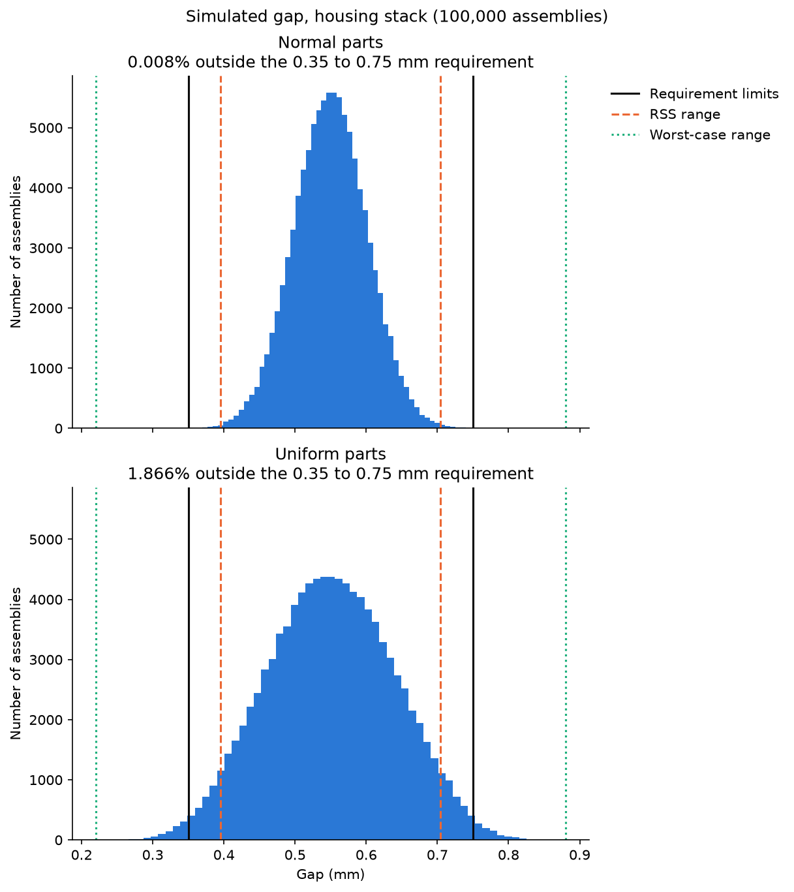
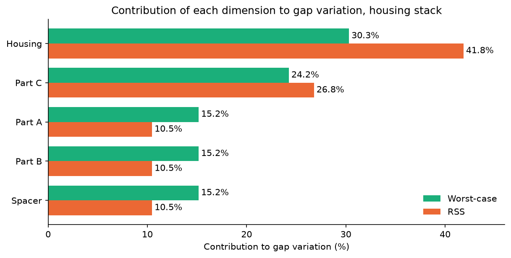

# Tolerance Stack-Up Calculator

A Python tool for 1D tolerance stack-ups that compares worst-case, RSS (root sum square) and Monte Carlo analysis on the same stack, so the method and its assumptions are visible next to every result.



The same five parts, checked against the same 0.35 to 0.75 mm gap requirement, give four different answers. Worst case says the design fails; RSS says it passes. Monte Carlo puts the real risk at 0.008% out of spec if the parts come from centered, normal processes, but 1.9% if they are spread evenly across their tolerances. The plot shows why: the uniform distribution is wider and its tails cross the requirement, while the normal one stays inside it and nowhere near the worst-case limits.

## What it does

| Method | Assumption | Output |
|---|---|---|
| Worst case | Every dimension can sit at its limit at the same time | Guaranteed min and max gap |
| RSS | Dimensions are normal, centered, independent, with tolerance = ±3σ | Statistical min and max gap (about 99.73% of assemblies) |
| Monte Carlo | Each dimension sampled independently from a normal or uniform distribution | The full distribution of gaps and the percentage outside any requirement |

It also reports each dimension's contribution to the variation under worst case and RSS, and plots the results.

## Example: housing stack

Five parts sit end to end inside a housing ([data/housing_stack.csv](data/housing_stack.csv)). The requirement is a gap of 0.35 to 0.75 mm.

| Dimension | Nominal (mm) | + tol | − tol | Direction |
|---|---|---|---|---|
| Housing | 50.00 | 0.10 | 0.10 | +1 |
| Part A | 12.00 | 0.05 | 0.05 | −1 |
| Part B | 15.50 | 0.05 | 0.05 | −1 |
| Spacer | 8.25 | 0.00 | 0.10 | −1 |
| Part C | 13.75 | 0.08 | 0.08 | −1 |

| Method | Result | Against 0.35 to 0.75 mm |
|---|---|---|
| Worst case | 0.220 to 0.880 mm | FAIL |
| RSS | 0.395 to 0.705 mm | PASS |
| Monte Carlo, normal parts | 0.008% outside (100,000 samples) | 8 in 100,000 |
| Monte Carlo, uniform parts | 1.866% outside (100,000 samples) | About 1 in 54 |



The housing drives the variation under both methods, and more so under RSS (41.8%), because RSS squares each tolerance: a tolerance twice as large has four times the influence. Tightening Part C from ±0.08 to ±0.05 mm narrows the RSS range to 0.409 to 0.691 mm ([learning/step7_what_if.ipynb](learning/step7_what_if.ipynb)).

## Installation

Requires Python 3.11 or newer.

```bash
git clone <repository-url>
cd tolerance-stackup
python3 -m venv .venv
source .venv/bin/activate
pip install -e ".[dev]"
```

`pip install -e` installs the package in editable mode and creates the `stackup` command. The `[dev]` extras add pytest and Jupyter support.

## Usage

### Command line

```bash
stackup data/housing_stack.csv --lower 0.35 --upper 0.75
```

```
Stack:        data/housing_stack.csv (5 dimensions)
Requirement:  0.350 to 0.750 mm
Worst case:   0.220 to 0.880 mm  FAIL
RSS:          0.395 to 0.705 mm  PASS
Monte Carlo:  0.008% outside the requirement (100,000 samples, normal parts, seed 42)
```

| Option | Default | Description |
|---|---|---|
| `--lower`, `--upper` | required | Gap requirement limits (mm) |
| `--samples` | 100000 | Number of simulated assemblies |
| `--distribution` | `normal` | `normal` or `uniform` part distribution |
| `--seed` | 42 | Random seed, so results can be reproduced |
| `--plot` | none | Save a histogram of the simulated gaps to this file |

Run `stackup --help` for the full list.

### Python

```python
import numpy as np
from stackup import calc_worst_case, calc_rss, simulate_gaps, calc_pct_out_of_spec

nominals = np.array([50.00, 12.00, 15.50, 8.25, 13.75])
plus_tols = np.array([0.10, 0.05, 0.05, 0.00, 0.08])
minus_tols = np.array([0.10, 0.05, 0.05, 0.10, 0.08])
directions = np.array([1, -1, -1, -1, -1])

min_gap, max_gap = calc_worst_case(nominals, plus_tols, minus_tols, directions)   # 0.220, 0.880
min_gap, max_gap = calc_rss(nominals, plus_tols, minus_tols, directions)          # 0.395, 0.705

gaps = simulate_gaps(nominals, plus_tols, minus_tols, directions, distribution="uniform")
calc_pct_out_of_spec(gaps, 0.35, 0.75)                                            # 1.866
```

Plotting functions are in `stackup.plots`: `plot_gap_histogram`, `plot_contributions` and `plot_gap_comparison`.

## Input format

A CSV file with one row per dimension in the loop:

| Column | Meaning |
|---|---|
| `name` | Dimension name |
| `nominal` | Nominal size (mm) |
| `plus_tol` | Plus tolerance, as a positive amount (mm) |
| `minus_tol` | Minus tolerance, as a positive amount (mm) |
| `direction` | `+1` if the dimension opens the gap, `-1` if it closes it |

A dimension toleranced +0.00/−0.10 is entered as `plus_tol = 0.00`, `minus_tol = 0.10`.

## Methods and assumptions

**Worst case.** For the maximum gap, every dimension that opens the gap is at its upper limit and every dimension that closes it is at its lower limit; the minimum gap is the reverse. The result is guaranteed but pessimistic: in 100,000 simulated assemblies with normal parts, none came within 0.1 mm of the worst-case limits.

**RSS.** Each dimension is first centered in its tolerance zone, so asymmetric tolerances are handled:

- center = nominal + (plus − minus) / 2
- half-band = (plus + minus) / 2
- gap center = Σ direction × center
- RSS ± = √(Σ half-band²)

This assumes each dimension is normally distributed, centered, independent of the others, with its tolerance equal to ±3σ (Cpk = 1). Even when those assumptions hold, about 0.27% of assemblies fall outside the RSS range. RSS is less reliable with few contributors, off-center or correlated processes, or Cpk below 1.

**Monte Carlo.** Each virtual assembly draws every dimension independently and sums them with their directions. `normal` uses σ = half-band / 3 around the center, the same assumptions as RSS. `uniform` spreads values evenly across the tolerance zone, a conservative choice when there is no process data. With RSS's assumptions, Monte Carlo reproduces RSS (0.283% outside the RSS range, against 0.27% expected), which is used as a check.

Monte Carlo results are estimates. Their sampling error shrinks with the square root of the number of samples and depends on how many assemblies fall outside the limit: aim for at least 100. The 0.008% normal result above is based on 8 hits in 100,000; with 5,000,000 samples it settles at about 0.0105%. A fixed seed makes every run reproducible.

## Tests

```bash
pytest
```

Nine tests check the calculations against hand calculations (worst case for two stacks, RSS, both contribution tables), cross-check functions against each other (contribution bands against the worst-case and RSS ranges), and test the random simulation by fixing the seed, checking its statistics against RSS within a stated tolerance, and confirming that an unknown distribution is rejected.

## Project layout

| Path | Contents |
|---|---|
| `src/stackup/core.py` | Worst-case, RSS, contribution and Monte Carlo functions |
| `src/stackup/plots.py` | Plotting functions |
| `src/stackup/cli.py` | The `stackup` command |
| `tests/` | pytest tests |
| `data/` | Example stack |
| `docs/images/` | Images used in this README |
| `learning/` | Step-by-step practice scripts and the what-if notebook |
| `PROGRESS.md` | Learning log |

## About this project

I'm a mechanical engineer who does tolerance stack-ups by hand at work. I built this to learn Python for engineering: first working each method the way I would on paper, then automating it, testing it against my hand calculations, and plotting the results. The `learning/` folder and `PROGRESS.md` record that process step by step, from first script to installable package.
